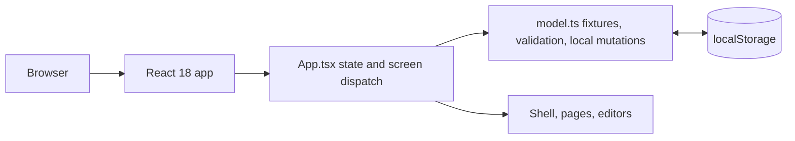
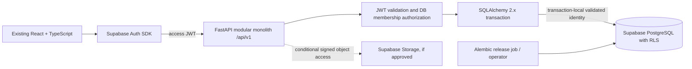

# 05 — System architecture

## Existing system (verified)

No URL router, API, auth, shared database or backend exists in the checkout. See [01](01-repository-audit.md).

## Target architecture (decided; planning only)

## Request lifecycle

React obtains/refreshes a Supabase session and sends the access JWT. FastAPI validates signature, issuer, audience, expiration/not-before and subject. It loads current active membership from the database; request identity and role fields are ignored. Router validates Pydantic input, service authorizes action, opens an explicit transaction, establishes RLS identity context, performs scoped SQLAlchemy operations, writes append-only activity in the same transaction, and commits. Errors become stable sanitized envelopes with request ID. RLS independently scopes reads/writes; service policy remains authoritative for product rules.

Direct PostgreSQL access is conditional, not yet approved. Use a non-BYPASSRLS application login and transaction-local trusted JWT settings/role only after the full staging gate in [08](08-authentication-authorization.md) passes, including `auth.uid()` subject matching and the actual pooler. Session-level settings are prohibited. If a condition fails or remains uncertain, use Supabase Data API with the user JWT for RLS-scoped operations. Do not use service-role credentials for normal request handling.

## Modular monolith

Proposed modules: `auth` (token verification/current user, not password endpoints), `users`, `workspaces`, `members`, `invitations`, `projects`, `tasks`, `meetings`, `resources`, `activity`; notifications/preferences conditional. Modules own routers, schemas, services, repositories/models, authorization and tests. Keep shared DB/session/error/pagination/config concerns in `core`, `database`, `common`. Avoid microservices and generic RBAC tables.

## Storage and migrations

Current resource upload stores metadata only. Supabase Storage and signed URLs are conditional; private bucket, project authorization and object-path scoping must be designed if binary files enter scope. Alembic owns schema history; application deployment must not auto-run migrations on every worker. A controlled nonproduction/production release job or operator applies reviewed migrations. Actual CI/hosting and migration owner remain UNKNOWN.
