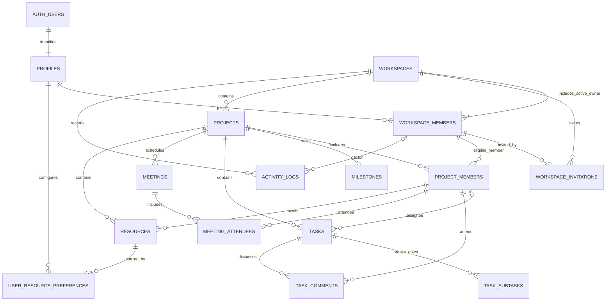

# 07 — MVP database ER diagram

Implemented table names and relationships align with [06](06-database-design.md) and Alembic revision `0002_mvp_schema`. `auth.users` remains external Supabase identity ownership. Conditional notification tables are not part of this schema.

The project-member links to task assignee, comment author, meeting attendee, and resource owner represent composite same-project membership FKs. Project and child rows also carry workspace context where needed for composite tenant constraints. Exactly one active workspace Owner is checked transactionally; the relationship is stored in `workspace_members`, and `workspaces` has no `owner_id`. Deferred database triggers enforce the Owner and Project Manager minimum-count invariants at transaction end.
