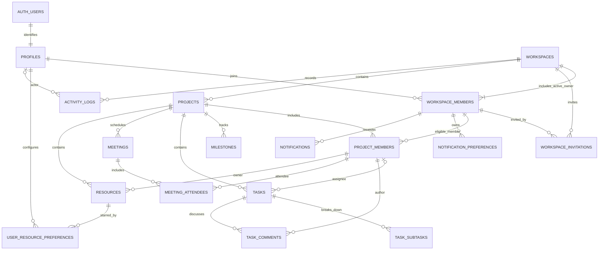

# 07 — Finalized proposed database ER diagram

Planning diagram; table names and relationships align with [06](06-database-design.md). `auth.users` is external Supabase identity ownership. Notification tables are conditional.

The project-member links to task assignee, comment author, meeting attendee, and resource owner all represent composite same-project membership FKs. Exactly one active workspace Owner is enforced transactionally; the relationship is stored in workspace_members and no owner_id exists on workspaces.
